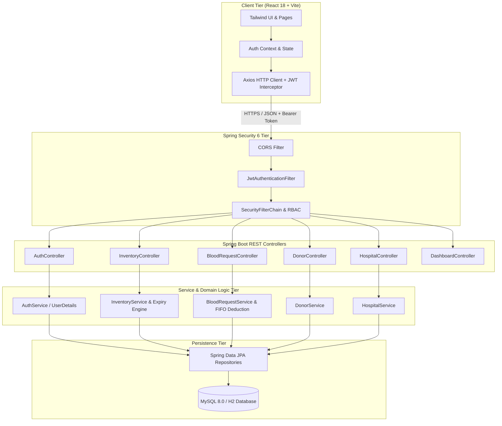
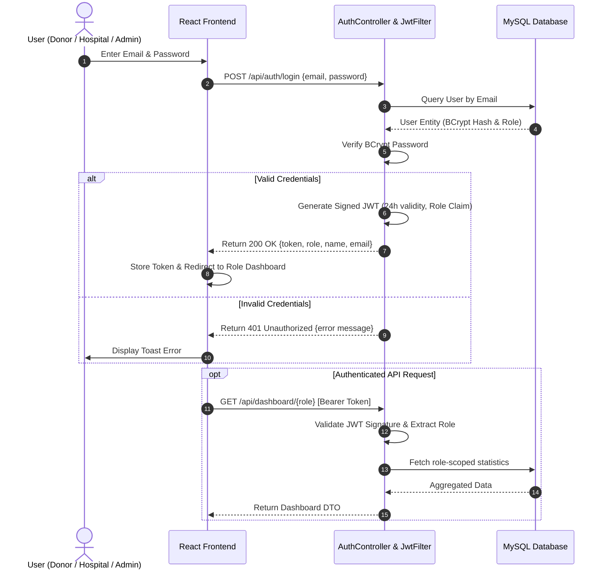
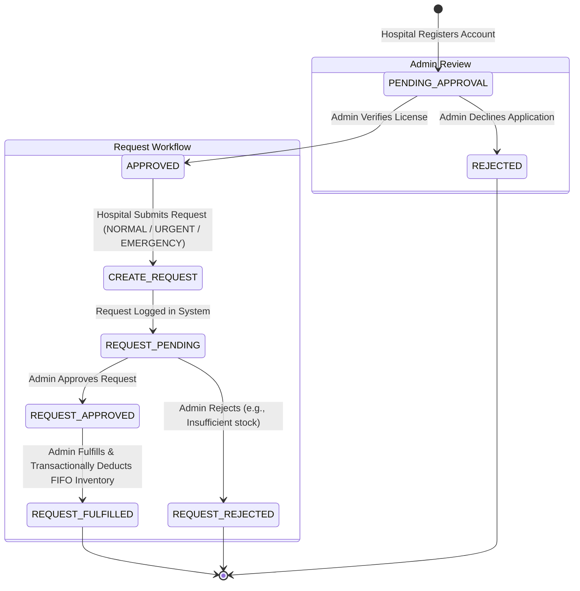
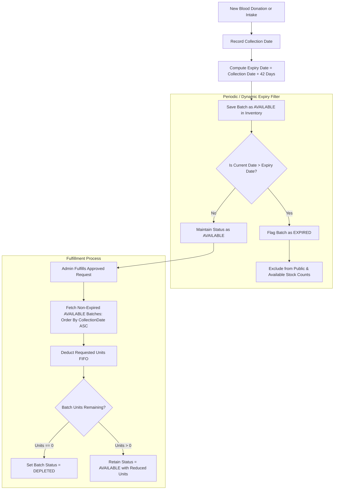
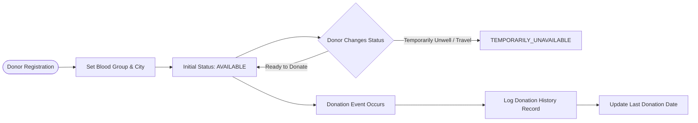

# 🩸 Lifeline — Blood Bank Management System

[](https://spring.io/projects/spring-boot)
[](https://kotlinlang.org/)
[](https://react.dev/)
[](https://vitejs.dev/)
[](https://tailwindcss.com/)
[](https://www.mysql.com/)
[](https://jwt.io/)

A full-stack, enterprise-grade digital **Blood Bank Management & Emergency Transfusion Platform**. Designed to bridge the critical gap between blood donors, registered healthcare facilities, and blood bank administrators with real-time inventory management, automated 42-day expiry tracking, triage-based emergency requests, and role-based access control.

---

## 📑 Table of Contents

- [📌 Project Overview](#-project-overview)
  - [The Problem](#the-problem)
  - [Our Solution](#our-solution)
  - [Target Roles & Stakeholders](#target-roles--stakeholders)
- [🛠️ Technology Stack](#️-technology-stack)
  - [Frontend Stack](#1-frontend-architecture)
  - [Backend Stack](#2-backend-architecture)
  - [Database & Storage](#3-database--storage)
  - [Security & Authentication](#4-security--authentication)
  - [Development & Tooling](#5-development--tooling)
- [🔄 System Architecture & Workflows](#-system-architecture--workflows)
  - [High-Level Architecture](#1-high-level-system-architecture)
  - [Authentication & RBAC Workflow](#2-authentication--authorization-rbac-workflow)
  - [Hospital Onboarding & Request Lifecycle](#3-hospital-onboarding--blood-request-lifecycle)
  - [Blood Inventory & 42-Day Expiry Engine](#4-blood-inventory--expiry-management-engine)
  - [Donor Management & Donation Flow](#5-donor-lifecycle--availability-workflow)
- [✨ Key Features](#-key-features)
- [🔑 Demo Login Credentials](#-demo-login-credentials)
- [🚀 Quick Start Guide](#-quick-start-guide)
  - [Prerequisites](#prerequisites)
  - [Option A: One-Command Start (Recommended)](#option-a-one-command-start-recommended)
  - [Option B: Run via VS Code Tasks](#option-b-run-via-vs-code-tasks)
  - [Option C: Manual Terminal Execution](#option-c-manual-terminal-execution)
- [📡 REST API Documentation](#-rest-api-documentation)
- [📁 Project Directory Structure](#-project-directory-structure)
- [🧪 Testing with Postman](#-testing-with-postman)
- [📄 License & Contribution](#-license--contribution)

---

## 📌 Project Overview

### The Problem
During medical emergencies, trauma surgeries, cancer treatments, and childbirth complications, rapid access to safe blood saves lives. However, traditional blood management faces major logistical challenges:
- **Inventory Mismatch & Stockouts**: Inability to anticipate shortages of rare blood groups (`O-`, `AB-`, `B-`).
- **Blood Wastage through Expiration**: Whole blood has a finite shelf-life of 42 days. Without batch tracking, older units expire undetected.
- **Unverified Hospital Requests**: Delays caused by manual paperwork and unauthenticated hospital procurement.
- **Donor Communication Bottlenecks**: Inability to quickly locate eligible, active, and available voluntary donors.

### Our Solution
**Lifeline Blood Bank Management System** provides a unified, reactive web ecosystem that connects all stakeholders in real time:
1. **Triaged Emergency Requests**: Hospitals submit requests classified by urgency (`NORMAL`, `URGENT`, `EMERGENCY`), enabling priority handling.
2. **Automated Expiry Tracking**: Automatically calculates batch expiration based on collection dates, excluding expired units from available stock.
3. **FIFO Inventory Deduction**: Approved requests are fulfilled using First-In-First-Out (FIFO) logic, reducing wastage of older safe batches.
4. **Vetted Hospital Network**: Hospitals must undergo administrative approval before requesting units.
5. **Donor Availability Switch**: Donors can update their availability status (`AVAILABLE` vs `TEMPORARILY_UNAVAILABLE`) to prevent false alarms.

### Target Roles & Stakeholders

```
+--------------------------------------------------------------------------+
|                  LIFELINE BLOOD BANK ECOSYSTEM                           |
+--------------------------------------------------------------------------+
|  👑 ADMINISTRATOR  | Full oversight: inventory, hospital approvals,      |
|                    | request fulfillment, donor directories, analytics.  |
|--------------------+-----------------------------------------------------|
|  🏥 HOSPITAL       | Verified medical centers: submit blood requests,   |
|                    | track urgency, view fulfillment status live.        |
|--------------------+-----------------------------------------------------|
|  🩸 DONOR          | Voluntary citizens: track donation history, toggle |
|                    | availability, update contact & blood group info.    |
|--------------------+-----------------------------------------------------|
|  🌐 PUBLIC VISITOR | Landing page access: live inventory summary,         |
|                    | blood compatibility charts, registration links.     |
+--------------------------------------------------------------------------+
```

---

## 🛠️ Technology Stack

Lifeline is built on modern, type-safe, resilient industry standards across both client and server tiers.

### 1. Frontend Architecture
- **Framework**: [React 18.3](https://react.dev/) — Component-driven reactive UI with Hooks and Context API.
- **Build Tool**: [Vite 5.2](https://vitejs.dev/) — Lightning-fast HMR (Hot Module Replacement) and optimized production bundling.
- **Styling**: [Tailwind CSS 3.4](https://tailwindcss.com/) — Utility-first modern responsive design system with custom color tokens.
- **Routing**: [React Router DOM v6](https://reactrouter.com/) — Declarative client-side routing with role-guarded routes (`ProtectedRoute`).
- **HTTP Client**: [Axios 1.6](https://axios-http.com/) — Promise-based HTTP client with centralized JWT interceptors and error handling.
- **Icons**: [Lucide React](https://lucide.dev/) — Clean, lightweight modern SVG icons.
- **Utility Libraries**: `clsx` and `tailwind-merge` for conditional class joining.

### 2. Backend Architecture
- **Language**: [Kotlin 1.9.23](https://kotlinlang.org/) — Concise, null-safe, functional JVM language running on **Java 17**.
- **Framework**: [Spring Boot 3.2.5](https://spring.io/projects/spring-boot) — Production-ready enterprise framework with auto-configuration.
- **Web MVC**: Spring Web for high-performance RESTful APIs and DTO serialization.
- **Data Persistence**: Spring Data JPA & [Hibernate 6](https://hibernate.org/orm/) — Object-Relational Mapping with automated schema management.
- **Data Validation**: [Jakarta Validation / Hibernate Validator](https://beanvalidation.org/) — Server-side input validation (`@Valid`, `@NotBlank`, `@Email`).
- **JSON Serialization**: Jackson with `jackson-module-kotlin` for idiomatic Kotlin data class support.

### 3. Database & Storage
- **Primary Database**: [MySQL 8.0](https://www.mysql.com/) — Relational data integrity, foreign key constraints, and transactional ACID guarantees.
- **Fallback / In-Memory Mode**: [H2 Database](https://www.h2database.com/) — Embedded memory database with MySQL syntax compatibility for rapid testing.
- **Database Script**: Complete schema and initial seed data provided in [`blood_bank_db.sql`](file:///c:/Users/SACHIN%20GOSWAMI/OneDrive/Desktop/PROJECT/Blood%20Management%20System/blood_bank_db.sql).

### 4. Security & Authentication
- **Security Engine**: [Spring Security 6](https://spring.io/projects/spring-security) — Filter-chain security with CORS filters and endpoint authorization rules.
- **Token Mechanism**: [JJWT 0.11.5 (Java JWT)](https://github.com/jwtk/jjwt) — Cryptographically signed HMAC-SHA256 stateless tokens with 24-hour expiration.
- **Password Protection**: BCrypt strong password hashing algorithm with salt generation.
- **Access Control**: Role-Based Access Control (**RBAC**) guarding endpoints for `ADMIN`, `HOSPITAL`, and `DONOR`.

### 5. Development & Tooling
- **Build System**: Maven Wrapper (`mvnw` / `mvnw.cmd`) — Self-contained builds without requiring manual Maven installation.
- **Concurrent Runner**: [Concurrently 9](https://www.npmjs.com/package/concurrently) — Single-command unified execution of frontend and backend.
- **IDE Support**: Pre-configured VS Code tasks and debug configurations in [`.vscode/`](file:///c:/Users/SACHIN%20GOSWAMI/OneDrive/Desktop/PROJECT/Blood%20Management%20System/.vscode).
- **API Testing**: Bundled Postman Collection ([`Blood_Bank_Management_System.postman_collection.json`](file:///c:/Users/SACHIN%20GOSWAMI/OneDrive/Desktop/PROJECT/Blood%20Management%20System/Blood_Bank_Management_System.postman_collection.json)).

---

## 🔄 System Architecture & Workflows

### 1. High-Level System Architecture

The following diagram illustrates how clients communicate with the backend services, security layer, and database:



---

### 2. Authentication & Authorization (RBAC) Workflow

All secured endpoints require a valid JWT passed in the `Authorization: Bearer <token>` header.



---

### 3. Hospital Onboarding & Blood Request Lifecycle

Hospitals cannot request blood until verified by an Administrator. Once approved, they can submit blood requests with urgency classification:



#### Step-by-Step Request Execution:
1. **Hospital Submission**: An approved hospital submits a blood request indicating:
   - Target Blood Group (e.g., `O+`, `A-`).
   - Units needed (e.g., `3 units`).
   - Urgency Level (`EMERGENCY` = immediate trauma care, `URGENT` = scheduled surgery, `NORMAL` = elective replenishment).
   - Clinical Reason and Patient Ward Details.
2. **Admin Evaluation**: The request displays in the Admin Dashboard with an urgency alert badge.
3. **Approval**: The Admin clicks **Approve**, validating the clinical justification.
4. **FIFO Fulfillment**: Upon clicking **Fulfill**, the system automatically executes a database transaction:
   - Queries available batches matching the blood group, sorted by oldest collection date.
   - Deducts units sequentially from older batches until the required units are fulfilled.
   - Sets batch status to `DEPLETED` if its units reach 0.
   - Transitions request status to `FULFILLED` and records timestamps.

---

### 4. Blood Inventory & Expiry Management Engine

Blood inventory is maintained in batch records, each tagged with collection date, expiry date, units, and status:



---

### 5. Donor Lifecycle & Availability Workflow



---

## ✨ Key Features

| Feature Area | Details & Capabilities |
| :--- | :--- |
| **🛡️ Security & RBAC** | Role-based authorization (`ADMIN`, `HOSPITAL`, `DONOR`), BCrypt password encryption, stateless JWT validation on every HTTP request. |
| **🩸 Inventory Control** | Batch-level tracking for 8 blood groups (`A+`, `A-`, `B+`, `B-`, `AB+`, `AB-`, `O+`, `O-`). Real-time units calculation and stock alerts. |
| **⏰ Automated Expiry** | Automatic 42-day whole blood shelf-life validation. Expired units are highlighted and barred from fulfillment. |
| **🚑 Priority Triage** | Requests tagged with `NORMAL`, `URGENT`, and `EMERGENCY` urgency levels to prioritize life-saving allocations. |
| **🔄 FIFO Fulfillment** | Automated transactional stock deduction taking from the oldest valid batches first to minimize waste. |
| **🏥 Hospital Vetting** | Hospital self-registration enters a `PENDING` queue until vetted and approved by an Administrator. |
| **🤝 Donor Management** | Donors can track donation records, view frequency, and toggle their active availability status. |
| **📊 Real-Time Analytics** | Live dashboard statistics for all roles (total units, pending approvals, urgent requests, donation history). |
| **🎨 Modern Responsive UI** | Clean Tailwind CSS interface with responsive tables, status badges, modal dialogs, and toast feedback. |

---

## 🔑 Demo Login Credentials

The application includes a `DataInitializer` that seeds verified demo accounts on first launch:

| Role | Email Address | Password | Permissions & Preloaded State |
| :--- | :--- | :--- | :--- |
| **👑 ADMIN** | `admin@bloodbank.org` | `Admin@123` | Full system control: inventory, hospitals, requests, stats |
| **🏥 HOSPITAL** | `hospital1@example.com` | `Hospital@123` | Metro General Hospital (`APPROVED` — can request blood) |
| **🏥 HOSPITAL** | `hospital2@example.com` | `Hospital@123` | City Care Medical Center (`PENDING` — awaiting approval) |
| **🩸 DONOR** | `donor1@example.com` | `Donor@123` | John Doe (`O+`, 2 previous donation records, `AVAILABLE`) |

> [!TIP]
> You can also register new Donors or new Hospitals directly from the web interface via the **Register** links on the navigation bar.

---

## 🚀 Quick Start Guide

### Prerequisites
Ensure you have the following installed on your machine:
- **Java Development Kit (JDK) 17** or higher (`java -version`)
- **Node.js 18+** and **npm** (`node -v`, `npm -v`)
- **MySQL 8.0** running on `localhost:3306` (Optional: The application automatically falls back to an embedded H2 database if MySQL is not detected).

---

### Option A: One-Command Start (Recommended)

From the project root directory, run:

```bash
# 1. Install root orchestrator dependencies (first time only)
npm install

# 2. Run both Frontend and Backend concurrently
npm start
```

This single command launches:
- 🌐 **Frontend (Vite + React)** on **`http://localhost:3000`**
- ⚙️ **Backend (Spring Boot + Kotlin)** on **`http://localhost:8080`**

---

### Option B: Run via VS Code Tasks

1. Open this project in **Visual Studio Code**.
2. Press `Ctrl + Shift + B` (or `Cmd + Shift + B` on macOS).
3. Select **`Run Full Stack (Frontend + Backend)`**.
4. Both services will run in integrated terminals with color-coded log streams.

---

### Option C: Manual Terminal Execution

#### 1. Start the Backend (Terminal 1)
```bash
cd backend

# Windows:
mvnw.cmd spring-boot:run

# Linux / macOS:
./mvnw spring-boot:run
```
*Backend initializes on **`http://localhost:8080`**.*

#### 2. Start the Frontend (Terminal 2)
```bash
cd frontend

# Install dependencies (first time only)
npm install

# Start development server
npm run dev
```
*Frontend opens at **`http://localhost:3000`**.*

---

## 📡 REST API Documentation

### 1. Authentication Endpoints (`/api/auth`)
| Method | Endpoint | Access | Description |
| :--- | :--- | :--- | :--- |
| `POST` | `/api/auth/login` | Public | Authenticates user; returns JWT token and role profile. |
| `POST` | `/api/auth/register/donor` | Public | Registers a new voluntary blood donor. |
| `POST` | `/api/auth/register/hospital` | Public | Registers a new hospital (initial status: `PENDING`). |
| `GET` | `/api/auth/me` | Authenticated | Retrieves current authenticated user profile. |

### 2. Blood Inventory Endpoints (`/api/inventory`)
| Method | Endpoint | Access | Description |
| :--- | :--- | :--- | :--- |
| `GET` | `/api/inventory/public/summary` | Public | Aggregate unit counts for all 8 blood groups. |
| `GET` | `/api/inventory` | Authenticated | Lists all blood batches with status and expiration. |
| `POST` | `/api/inventory` | `ADMIN` | Adds a new blood inventory batch. |
| `PUT` | `/api/inventory/{id}` | `ADMIN` | Updates units or status of an existing batch. |
| `DELETE` | `/api/inventory/{id}` | `ADMIN` | Deletes a batch record from inventory. |

### 3. Blood Request Endpoints (`/api/requests`)
| Method | Endpoint | Access | Description |
| :--- | :--- | :--- | :--- |
| `POST` | `/api/requests` | `HOSPITAL` | Submits a blood request (`NORMAL`, `URGENT`, `EMERGENCY`). |
| `GET` | `/api/requests` | `ADMIN` | Lists all blood requests across all hospitals. |
| `GET` | `/api/requests/hospital/{id}` | `HOSPITAL`, `ADMIN` | Lists blood requests submitted by a specific hospital. |
| `PUT` | `/api/requests/{id}/approve` | `ADMIN` | Approves a pending request with optional remarks. |
| `PUT` | `/api/requests/{id}/reject` | `ADMIN` | Rejects a request with an explanation. |
| `PUT` | `/api/requests/{id}/fulfill` | `ADMIN` | Fulfills request and executes FIFO inventory stock deduction. |

### 4. Hospital & Donor Management (`/api/hospitals`, `/api/donors`)
| Method | Endpoint | Access | Description |
| :--- | :--- | :--- | :--- |
| `GET` | `/api/hospitals` | `ADMIN` | Lists all registered hospitals and approval statuses. |
| `PUT` | `/api/hospitals/{id}/approve` | `ADMIN` | Approves a hospital registration. |
| `PUT` | `/api/hospitals/{id}/reject` | `ADMIN` | Declines a hospital registration. |
| `GET` | `/api/donors` | `ADMIN` | Lists all registered donors. |
| `GET` | `/api/donors/me` | `DONOR` | Fetches logged-in donor profile and donation history. |
| `PUT` | `/api/donors/me/availability` | `DONOR` | Toggles availability (`AVAILABLE` / `TEMPORARILY_UNAVAILABLE`). |

### 5. Dashboards (`/api/dashboard`)
| Method | Endpoint | Access | Description |
| :--- | :--- | :--- | :--- |
| `GET` | `/api/dashboard/admin` | `ADMIN` | Aggregated metrics: total donors, hospitals, stock, urgent alerts. |
| `GET` | `/api/dashboard/hospital` | `HOSPITAL` | Hospital-specific counts: active requests, approvals, fulfillments. |
| `GET` | `/api/dashboard/donor` | `DONOR` | Donor-specific stats: total donations, last donated, availability. |

---

## 📁 Project Directory Structure

```
Blood Management System/
├── backend/                                   # Kotlin / Spring Boot 3 Backend
│   ├── src/main/kotlin/com/example/bloodbank/
│   │   ├── config/
│   │   │   └── DataInitializer.kt             # Seeds sample Admin, Donors, Hospitals, Inventory
│   │   ├── controller/                        # REST Controllers
│   │   │   ├── AuthController.kt              # Login & registration endpoints
│   │   │   ├── BloodRequestController.kt      # Request lifecycle & fulfillment
│   │   │   ├── DashboardController.kt         # Live metric aggregations
│   │   │   ├── DonorController.kt             # Donor directory & availability
│   │   │   ├── HospitalController.kt          # Hospital management & vetting
│   │   │   └── InventoryController.kt         # Batch inventory & expiry logic
│   │   ├── dto/                               # Request/Response Data Transfer Objects
│   │   ├── entity/                            # JPA Database Entities & Enums
│   │   │   ├── User.kt, Donor.kt, Hospital.kt # User profiles & roles
│   │   │   ├── BloodInventory.kt              # Batch entity with 42-day expiry
│   │   │   ├── BloodRequest.kt                # Request entity with urgency status
│   │   │   └── Donation.kt                    # Historical donation records
│   │   ├── repository/                        # Spring Data JPA Repositories
│   │   ├── security/                          # Security Configuration & JWT
│   │   │   ├── JwtTokenProvider.kt            # Token generation & verification
│   │   │   ├── JwtAuthenticationFilter.kt     # Per-request Bearer token filter
│   │   │   ├── SecurityConfig.kt              # Filter chain, CORS & endpoint permissions
│   │   │   └── UserPrincipal.kt               # Spring Security UserDetails implementation
│   │   └── service/                           # Business & Transactional Logic
│   ├── src/main/resources/
│   │   └── application.yml                    # Database, JWT & server settings
│   ├── pom.xml                                # Maven build definitions & dependencies
│   └── mvnw.cmd / mvnw                        # Maven wrapper scripts
│
├── frontend/                                  # React 18 + Vite Frontend
│   ├── src/
│   │   ├── components/                        # Reusable UI Components
│   │   │   ├── Navbar.jsx                     # Navigation bar with role badges & logout
│   │   │   ├── Sidebar.jsx                    # Dashboard navigation sidebar
│   │   │   ├── StatCard.jsx                   # Metric card component
│   │   │   ├── StatusBadge.jsx                # Urgency & status visual tags
│   │   │   └── Modal.jsx                      # Pop-up modal dialog for forms
│   │   ├── context/
│   │   │   └── AuthContext.jsx                # Global authentication state provider
│   │   ├── pages/                             # Application View Pages
│   │   │   ├── LandingPage.jsx                # Public home with live inventory counter
│   │   │   ├── LoginPage.jsx                  # Multi-role authentication page
│   │   │   ├── DonorRegisterPage.jsx          # Donor registration form
│   │   │   ├── HospitalRegisterPage.jsx       # Hospital onboarding form
│   │   │   ├── AdminDashboard.jsx             # Comprehensive Admin control center
│   │   │   ├── HospitalDashboard.jsx          # Hospital blood request center
│   │   │   └── DonorDashboard.jsx             # Donor profile & donation log
│   │   ├── routes/
│   │   │   └── ProtectedRoute.jsx             # Guards routes based on JWT and Role
│   │   ├── services/
│   │   │   └── api.js                         # Centralized Axios client with JWT interceptor
│   │   ├── App.jsx                            # Route tree configuration
│   │   └── index.css                          # Custom Tailwind utility rules
│   ├── package.json                           # Frontend dependencies & scripts
│   ├── tailwind.config.js                     # Tailwind theme and color extensions
│   └── vite.config.js                         # Vite dev server configuration (port 3000)
│
├── .vscode/                                   # VS Code launch & task configurations
│   ├── launch.json                            # Debugger setups
│   └── tasks.json                             # One-click build & run tasks
├── blood_bank_db.sql                          # Full MySQL database schema & sample dump
├── Blood_Bank_Management_System.postman_collection.json # Ready-to-import Postman suite
├── package.json                               # Root package script for concurrent startup
└── README.md                                  # Complete project documentation
```

---

## 🧪 Testing with Postman

A pre-configured Postman collection is included in the project root:
📂 **[`Blood_Bank_Management_System.postman_collection.json`](file:///c:/Users/SACHIN%20GOSWAMI/OneDrive/Desktop/PROJECT/Blood%20Management%20System/Blood_Bank_Management_System.postman_collection.json)**

### How to Test:
1. Open **Postman** and click **Import** ➔ select `Blood_Bank_Management_System.postman_collection.json`.
2. Run the **`Login (Admin)`** request under the **Authentication** folder.
3. The response includes an `accessToken`. Postman will automatically set this to the collection variable `token` (or paste it into Authorization tab as `Bearer Token`).
4. Test all endpoints across **Inventory**, **Requests**, **Hospitals**, and **Donors**.

---

## 📄 License & Contribution

- **License**: Released under the [MIT License](https://opensource.org/licenses/MIT). Open-source for educational, institutional, and healthcare purposes.
- **Contributions**: Contributions, issues, and feature requests are welcome! Feel free to check the issues tab or submit a pull request.

---

<p align="center">
  <b>Built with ❤️ for saving lives through technology.</b>
</p>
